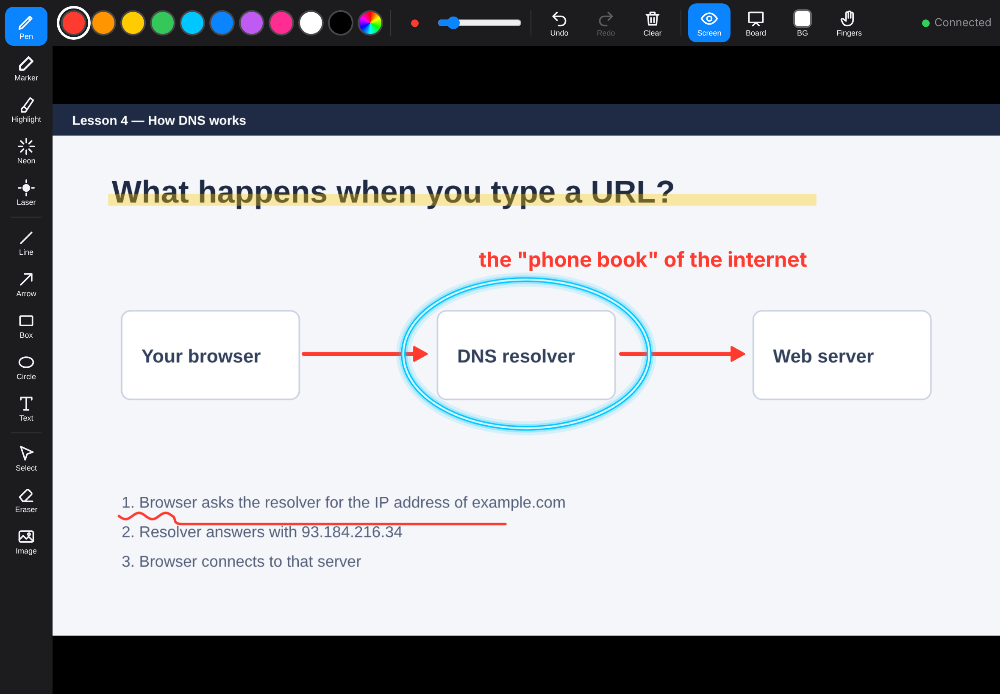
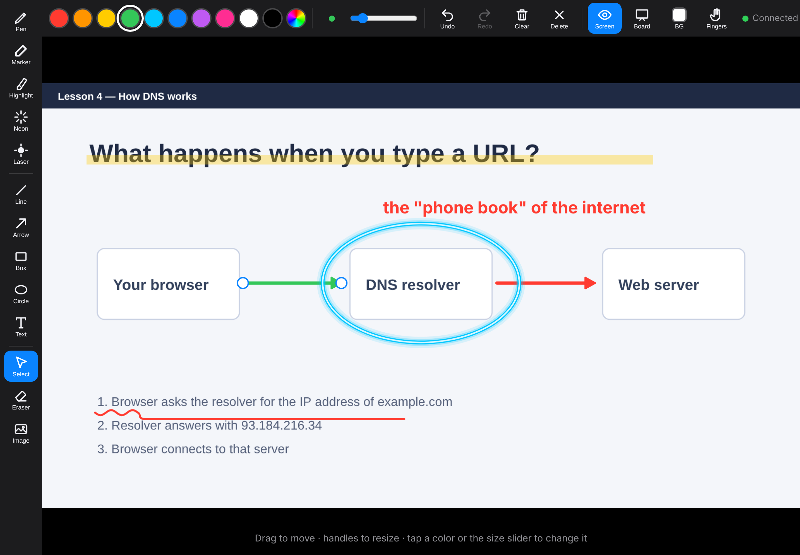
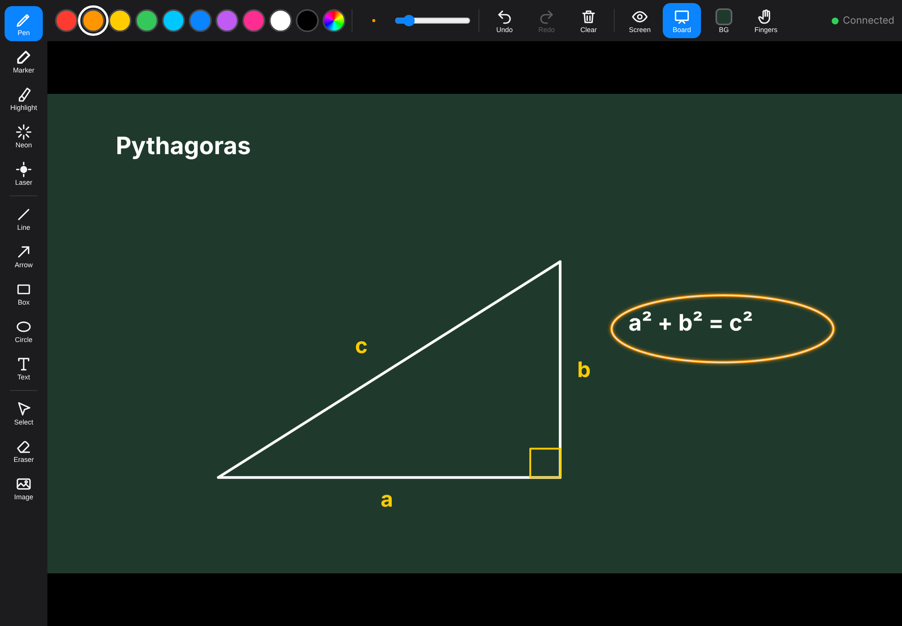

# iPad Ink

Draw live on your Windows screen using an iPad and a pencil.

Your PC gets an invisible, click-through ink layer on top of everything. Open a page in Safari on the iPad, and whatever you draw there shows up on the PC instantly, while your mouse and keyboard keep working normally underneath. Screen recorders like OBS capture the ink, which makes it handy for teaching and tutorial videos.

No iPad app to install. No subscription.



## Features

- **Pens:** pen, marker, highlighter, neon (glowing ink) and a laser pointer that fades away on its own
- **Shapes:** line, arrow, box, circle
- **Text:** tap to type; tap existing text to edit it
- **Images:** drop in pictures or logos from your iPad's Photos
- **Select:** move anything, drag line and arrow ends, resize shapes, handwriting, text and images, and change their color or size
- **Whiteboard:** switch to a blank board (white, grid, black or green chalkboard) and back; the screen and the board keep separate drawings
- **Undo / redo, eraser, clear**
- **Palm-safe:** only the pencil draws by default; finger drawing can be turned on
- **Live screen preview** on the iPad so you can see where you're drawing
- **PC keyboard shortcuts** so you can control it without touching the iPad





## Requirements

- Windows 10 or 11
- [Python 3.10+](https://www.python.org/downloads/) (tick **"Add python.exe to PATH"** during install)
- An iPad (with Apple Pencil or a compatible stylus) on the **same WiFi network** as the PC

## Getting started

1. Download this repository (green **Code** button → **Download ZIP**) and unzip it.
2. Double-click **`Start iPad Ink.bat`**. The first run installs what it needs (PySide6, aiohttp, mss, Pillow), which takes a minute.
3. If Windows asks about the firewall, click **Allow**.
4. The window shows an address like `http://192.168.0.105:8765`. Open it in **Safari** on your iPad.
5. Optional: in Safari tap **Share → Add to Home Screen** so it opens full screen like an app.

Or run it directly:

```bash
pip install PySide6 aiohttp mss pillow
python ipad_ink.py
```

## PC shortcuts

| Shortcut | Action |
|---|---|
| `Ctrl+Alt+Z` / `Ctrl+Alt+Y` | Undo / Redo |
| `Ctrl+Alt+C` | Clear ink |
| `Ctrl+Alt+H` | Hide / show ink |
| `Ctrl+Alt+L` | Laser pointer on / off |
| `Ctrl+Alt+W` | Whiteboard on / off |
| `Ctrl+Alt+B` | Change whiteboard background |

The tray icon (red circle near the clock) also has Clear, Whiteboard, Hide and Quit.

## Tips

- For the lowest lag, connect the PC to the router with a cable and put the iPad on 5 GHz WiFi.
- Turn off any VPN on the PC; it can stop the iPad from reaching it.
- If your stylus doesn't draw, tap **Fingers** in the top bar (some styluses register as touch).
- The ink draws on your primary monitor.

## How it works

`ipad_ink.py` runs three things:

1. A transparent, always-on-top window that ignores mouse input and renders the ink with Qt.
2. A small web server that serves the iPad page and receives pen strokes over a WebSocket.
3. A screen capture that sends a low-resolution preview back to the iPad.

Only stroke coordinates travel over the network, not video, so ink appears on the PC within a few milliseconds on a good local network.
