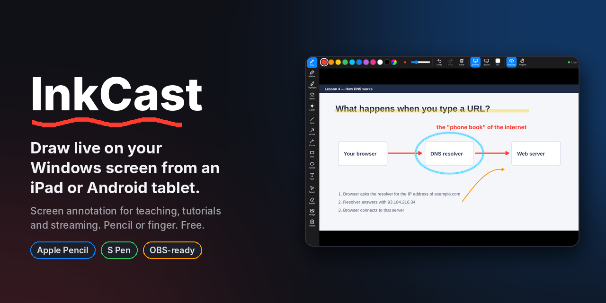
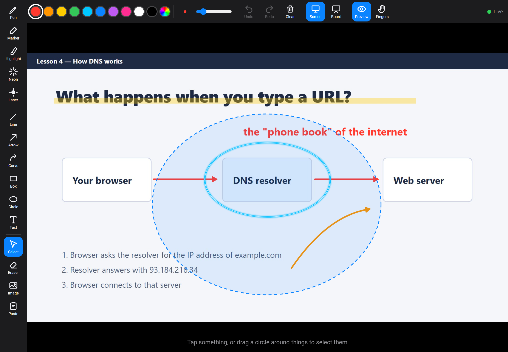

# InkCast: draw on your Windows screen from an iPad or Android tablet



[](LICENSE)


**InkCast is a free, open-source screen annotation tool that turns your iPad or Android tablet into a wireless drawing pad for your Windows PC.** Write, highlight, draw arrows and point with a laser on top of anything on your screen (slides, code, browser, PDFs, videos) using an Apple Pencil, Samsung S Pen, any stylus, or just your finger.

Your PC gets an invisible, click-through ink layer on top of everything. Open a page in your tablet's browser, and whatever you draw there shows up on the PC instantly, while your mouse and keyboard keep working normally underneath. Screen recorders and streaming software like OBS capture the ink, which makes it ideal for teaching, online classes, tutorial videos and live streams.

No tablet app to install. No subscription. No account.


## Who it's for

- **Teachers and tutors** recording lessons or teaching online over Zoom, Google Meet or Teams
- **YouTubers and course creators** who want to draw on screen while recording
- **Streamers** who want to sketch, circle and point during a live stream
- **Anyone presenting** who wants a laser pointer and whiteboard without buying a drawing tablet

## Features

- **Pens:** pen, marker, highlighter, neon (glowing ink) and a laser pointer that fades away on its own
- **Shapes:** line, arrow, **curved arrow**, box, circle
- **Text** in three fonts (sans, handwriting, serif); tap existing text to edit it
- **Images:** pick from your tablet, paste from the clipboard, drag and drop, or copy an image on the PC and press `Ctrl+Alt+V`
- **Select:** tap one thing, or draw a loop around several. Then move them, resize them from the corner dots, or change their color, size or font together
- **Whiteboard:** switch between your screen and a blank board (white, grid, black or green chalkboard); each keeps its own drawings
- **Undo / redo, eraser, clear**
- **Works with fingers or a pencil.** When a pencil is detected, fingers stop drawing automatically so your palm can rest on the screen (toggle with **Fingers**)
- **Live screen preview** on the tablet so you can see where you're drawing
- **PC keyboard shortcuts** so you can control it without touching the tablet
- **Phone camera over USB:** use your Android phone as a face cam or document cam, with no app on the phone ([details](#use-your-android-phone-as-a-camera-usb-no-app))

| Loop to select | Edit many things at once |
|---|---|
|  |  |


## Requirements

- Windows 10 or 11
- [Python 3.10+](https://www.python.org/downloads/) (tick **"Add python.exe to PATH"** during install)
- A tablet (iPad or Android) on the **same WiFi network** as the PC, using Safari, Chrome or another modern browser

## Getting started

**Before you start:** install [Python](https://www.python.org/downloads/) if you don't have it. On the first screen of the installer, tick **"Add python.exe to PATH"**.

### First time (about 2 minutes)

1. **Make a folder** for InkCast anywhere, for example on your Desktop, and open it.
2. **Open a terminal in that folder:** click the address bar at the top of the window, type `powershell`, and press **Enter**.
3. **Download InkCast** by pasting this and pressing Enter:
   ```powershell
   Invoke-WebRequest https://github.com/ssfshad/inkcast/archive/refs/heads/main.zip -OutFile inkcast.zip; Expand-Archive inkcast.zip .; Remove-Item inkcast.zip; cd inkcast-main
   ```
   This puts InkCast in a new `inkcast-main` folder and moves the terminal into it.
4. **Install what it needs:**
   ```powershell
   pip install -r requirements.txt
   ```
5. **Start InkCast:**
   ```powershell
   python inkcast.py
   ```
6. If Windows asks about the firewall, click **Allow**.
7. InkCast shows an address like `http://192.168.0.105:8765`. **Open it in your tablet's browser** (the tablet must be on the same WiFi).

### Every time after that

Open the `inkcast-main` folder and double-click **`Start InkCast.bat`**. No terminal needed.

> **Tip:** add the page to your tablet's home screen (Safari: **Share → Add to Home Screen**; Chrome: **⋮ → Add to Home screen**) so it opens full screen like an app.

### Troubleshooting

- **`No such file or directory: 'requirements.txt'`** or **`can't open file 'inkcast.py'`**: the terminal isn't inside the `inkcast-main` folder. Run `cd inkcast-main` and try again.
- **`python` is not recognized:** Python isn't installed or wasn't added to PATH. Reinstall it and tick **"Add python.exe to PATH"**.
- **The tablet can't open the address:** make sure both devices are on the same WiFi, turn off any VPN on the PC, and check that you clicked **Allow** on the firewall message.

## PC shortcuts

| Shortcut | Action |
|---|---|
| `Ctrl+Alt+Z` / `Ctrl+Alt+Y` | Undo / Redo |
| `Ctrl+Alt+C` | Clear ink |
| `Ctrl+Alt+H` | Hide / show ink |
| `Ctrl+Alt+L` | Laser pointer on / off |
| `Ctrl+Alt+W` | Whiteboard on / off |
| `Ctrl+Alt+B` | Change whiteboard background |
| `Ctrl+Alt+V` | Paste the image you copied on the PC |

The tray icon (red circle near the clock) also has Paste, Clear, Whiteboard, Hide and Quit.

## Pasting images

- **On the PC:** right-click any image in your browser → **Copy image**, then press `Ctrl+Alt+V`. It appears in the middle of the screen, already selected so you can drag and resize it.
- **On the tablet:** copy an image in your browser, tap **Paste** in the tool bar, then long-press the box and choose **Paste**. If only a link was copied, the PC downloads the image for you.
- You can also tap **Image** to pick from your photos, or drag an image onto the page.

## Use your Android phone as a camera (USB, no app)

Turn your Android phone into a smooth, low-lag camera for your recordings: a **face cam** in the corner, a **document camera** pointed at paper or a book, or a **full-screen live camera you can draw over** with InkCast. It runs over a USB cable, so it doesn't depend on WiFi, and nothing gets installed on the phone.

**Needs:** Android 12 or newer and a USB cable.

1. **On the phone, once:** go to **Settings → About phone** and tap **Build number** 7 times. Then open **Developer options** and turn on **USB debugging**.
2. Plug the phone into the PC.
3. Double-click **`camera\InkCast Camera.bat`**, or choose **Phone camera (USB)** in the InkCast tray menu. The first time, it offers to download [scrcpy](https://github.com/Genymobile/scrcpy) from its official GitHub release and checks the download's checksum.
4. On the phone, tap **Allow** on "Allow USB debugging?" (tick *Always allow*).
5. Pick a mode, rotation and zoom. Your choices are remembered, so next time you just press Enter.

| Mode | Use it for |
|---|---|
| **1 · Front camera, window** | Face cam. Add it in OBS with **Window Capture → [scrcpy.exe]: Camera** |
| **2 · Back camera, window** | Document cam: paper, books, circuits, handwriting |
| **3 · Back camera, full screen** | Draw over the live camera with InkCast, captured by your normal screen recording |

While it runs: **Alt + ↑ / ↓** zoom, **Alt + ← / →** rotate, **Alt + F** full screen.

> Want it as a webcam in Zoom, Meet or Teams? Add the camera window to OBS and click **Start Virtual Camera**, then pick *OBS Virtual Camera* as your webcam in the meeting app.

## Tips

- For the lowest lag, connect the PC to the router with a cable and put the tablet on 5 GHz WiFi.
- Turn off any VPN on the PC; it can stop the tablet from reaching it.
- **Fingers** on = fingers draw. Off = only the pencil draws. It switches off automatically the first time a pencil is used.
- **Preview** turns the live PC picture on the tablet on or off. **Screen** and **Board** switch where you're drawing.
- The ink draws on your primary monitor.

## How InkCast compares

| | InkCast | Screen-drawing apps (Epic Pen, ZoomIt, gInk) | Tablet-as-monitor apps (Spacedesk, Duet, Astropad) |
|---|---|---|---|
| Draw from a tablet | Yes | No, you draw with the PC's mouse or pen | Yes |
| Mouse keeps working while you draw | Yes, the tablet has its own ink layer | No, drawing takes over the cursor | No, the pencil moves the PC's cursor |
| Works on iPad and Android | Both | n/a | Varies by app |
| Price | Free and open source | Free / paid | Free to subscription |

## FAQ

**Can I use my iPad as a drawing tablet for Windows?**
Yes. Run InkCast on the PC, open the address it shows in Safari on the iPad, and draw with an Apple Pencil (or your finger). The ink appears on your Windows screen live.

**Does it work with Android tablets and the Samsung S Pen?**
Yes. Open the page in Chrome on any Android tablet. S Pen, other styluses and fingers all work.

**Does the ink show up in OBS, Zoom or screen recordings?**
Yes. The ink is drawn on your real screen, so anything that captures the screen (OBS, Streamlabs, Zoom, Teams, Google Meet, the Xbox Game Bar recorder) captures it too.

**Do I need to install an app on the tablet?**
No. It runs in the tablet's browser. You can add it to the home screen to open it full screen like an app.

**Does it need the internet?**
Only for the first install. After that the PC and tablet talk directly over your local WiFi; nothing is sent to the cloud. (Pasting an image link is the exception: the PC downloads that image.)

**Is there lag?**
Very little on a normal home network. Only pen coordinates travel over WiFi, not video. A cable from the PC to the router and 5 GHz WiFi on the tablet give the best results.

**Can I use it as a whiteboard?**
Yes. Tap **Board** for a white, grid, black or green chalkboard background, and tap **Screen** to go back. Each keeps its own drawings.

**Can I use my Android phone as a webcam without installing an app?**
Yes. InkCast's camera launcher streams your phone's camera to the PC over USB using scrcpy, with nothing installed on the phone. It needs Android 12 or newer with USB debugging turned on. See [Use your Android phone as a camera](#use-your-android-phone-as-a-camera-usb-no-app).

**Does it work on Mac or Linux?**
The PC side is built and tested for Windows 10 and 11. Most of it is cross-platform Python, but keyboard shortcuts and fonts are Windows-specific for now.

## How it works

`inkcast.py` runs three things:

1. A transparent, always-on-top window that ignores mouse input and renders the ink with Qt. Only the part of the screen that changed is repainted.
2. A small web server that serves the tablet page and receives pen input over a WebSocket. Strokes are sent the moment they happen, and moving or resizing a selection sends a single tiny transform instead of all the points.
3. A screen capture that sends a low-resolution preview back to the tablet. It slows down while you draw so the pen gets the network first.

Text uses the same font files on both ends (the PC shares its fonts with the tablet), so text looks the same in both places.

## Credits

The phone camera feature uses [scrcpy](https://github.com/Genymobile/scrcpy) by Genymobile (Apache License 2.0). It's downloaded from its official release on first use and isn't bundled with InkCast.

## License

[Apache License 2.0](LICENSE)
