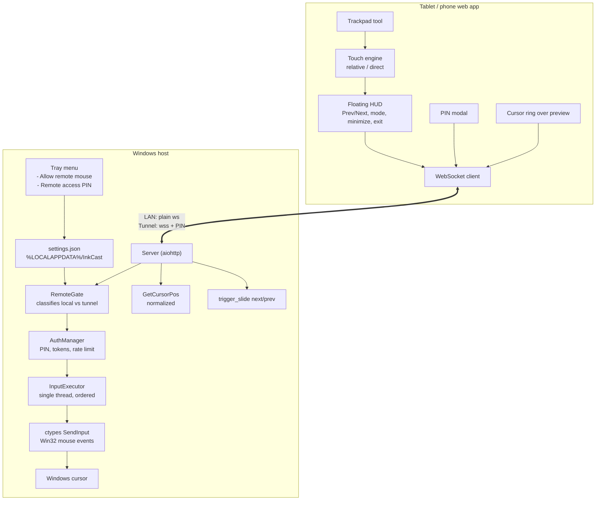

# Design Spec v2: Remote Trackpad & Presentation Control for InkCast

**Date:** 2026-11-07
**Status:** Draft (v2) — supersedes the v1 draft of the same date
**Target:** `inkcast.py` (single-file app, ~2480 lines, embedded HTML page)

---

## 0. What changed from v1

| v1 said | v2 says | Why |
|---|---|---|
| `{"type": "mouse", ...}` | `{"t": "mouse", ...}` | The server reads `d.get("t")`; a `type` key falls through to `apply()` and reaches the ink overlay as junk |
| PIN gates **mouse only** | PIN gates the **whole remote session** (preview, drawing, mouse) | The live screen preview is an unauthenticated screen capture over a public tunnel — bigger hole than mouse control |
| PIN asked on every connection | PIN asked only when the session arrives through the tunnel | LAN stays frictionless; the tunnel is the only internet-facing surface |
| Default PIN `1234` | 6–8 digits, stored as a SHA-256 hash, **fail-closed** | 4 digits is brute-forceable even with a rate limit; fail-closed means "not my LAN ⇒ needs the PIN" |
| Rate limit "per IP" | per **real** client IP (`CF-Connecting-IP` first) | Under a tunnel every client appears as `127.0.0.1` |
| Client sends a PIN every time | Server issues a bearer token; client keeps it in `localStorage` | The client auto-reconnects every second — re-typing a PIN on every drop is unusable |
| Separate mouse PIN + mouse killswitch | One PIN (remote entry) + one killswitch (mouse) | Two PINs for one user is one too many |
| Acceleration curve `dx·(1+|dx|·0.05)` | Proportional mapping, client-side speed slider | Windows already applies its own pointer acceleration; two curves compound unpredictably |
| Goals 1–5 as new features | Slide controls, WS transport, preview, toolbar, QR, tray all **reused** | See §2 |
| "60 fps over Cloudflare Tunnel" | 60 fps on LAN, "usable" over a tunnel | A tunnel round trip is tens of milliseconds; 60 fps is not a tunnel target |
| No cursor feedback | Server reports the cursor position with every frame | `mss` does not capture the OS cursor — without this, relative mode is blind |
| — | Input runs on a dedicated single-thread executor | The existing 2-worker pool is shared with screen capture and can reorder mouse moves |

---

## 1. Goals

1. **Remote trackpad** — a tablet/phone acts as a trackpad or direct-touch surface for the Windows host cursor.
2. **Presentation controls in the foreground** — Prev/Next reachable in landscape without hunting for them in the scrolling top bar.
3. **Cursor visibility on the tablet** — the host cursor is drawn on the live preview.
4. **One rule for the internet** — anything that is not my own LAN needs the PIN.
5. **Zero new dependencies** — `ctypes` only for input, `aiohttp` for transport, PySide6 for the tray.

Non-goals: typing on the host keyboard, multi-touch gestures beyond tap/scroll, controlling the PC while the tablet is on a different LAN than the host.

---

## 2. Reuse map — what already exists (do not rebuild)

| Need | Existing code | Line |
|---|---|---|
| WebSocket transport, auto-reconnect, message batching | `connect()`, `send()`, `sendNow()` | [inkcast.py:2059-2128](inkcast.py#L2059-L2128) |
| Slide prev/next from the tablet | `sendSlide()`, `prevB`/`nextB` buttons | [inkcast.py:1667](inkcast.py#L1667), [inkcast.py:1692](inkcast.py#L1692) |
| Host-side slide key injection | `trigger_slide()` | [inkcast.py:871](inkcast.py#L871) |
| Live screen preview (JPEG over the same WS) | `send_frame()`, `{"t":"f"}` | [inkcast.py:669](inkcast.py#L669), [inkcast.py:2074](inkcast.py#L2074) |
| Screen size / aspect | `Server(bridge, aspect)` | [inkcast.py:1244](inkcast.py#L1244) |
| Tool system + toolbar | `TOOLS`, `setTool()`, `ui()` | [inkcast.py:1535](inkcast.py#L1535), [inkcast.py:1759](inkcast.py#L1759) |
| Modal dialog pattern | `#pastebox` | [inkcast.py:1481](inkcast.py#L1481), [inkcast.py:2461](inkcast.py#L2461) |
| Per-user app folder | `%LOCALAPPDATA%\InkCast\` (already holds `cloudflared.exe`) | [inkcast.py:1000](inkcast.py#L1000) |
| Tray menu, toast, QR code | `main()`, `tray_icon()`, `qr_pixmap()` | [inkcast.py:1249](inkcast.py#L1249), [inkcast.py:939](inkcast.py#L939) |

---

## 3. Architecture



---

## 4. Subsystems

### 4.1 Local vs remote classification

A session is **remote** when it arrives through the Cloudflare tunnel or a custom domain, **local** otherwise.

`request.remote` cannot be used: `cloudflared` connects from the host machine itself (`http://127.0.0.1:{port}`, [inkcast.py:1043](inkcast.py#L1043)), so tunnel traffic also appears as `127.0.0.1`.

```python
def is_remote(request) -> bool:
    if request.headers.get("CF-Connecting-IP"):
        return True                      # definitely came through the tunnel
    host = (request.host or "").lower()
    try:
        ipaddress.ip_address(host)
        return False                     # direct LAN access by IP
    except ValueError:
        return host not in ("localhost", "127.0.0.1", "::1")
```

Anything that is not an IP or `localhost` counts as remote — the failure direction is "asks for the PIN", which is the safe one.

The **real client IP** (used for rate limiting) is:

```python
def client_ip(request) -> str:
    return request.headers.get("CF-Connecting-IP") or request.remote or "?"
```

### 4.2 PIN authentication

**Rules**

| Session | PIN required | Mouse additionally requires |
|---|---|---|
| Local (LAN / localhost) | no | the tray killswitch |
| Remote (tunnel / domain) | yes | the tray killswitch |

A remote session that has not authenticated may do **nothing**: no preview frame, no drawing op, no mouse command, no slide trigger. The check sits in front of every message in `ws_handler`.

**Fail-closed:** if no PIN is configured, remote sessions are refused outright ("Remote access is locked — the host must set a PIN"). A host that wants open access can set a PIN and share it; there is no open mode.

**PIN strength:** 6–8 digits, digits only, stored hashed. A 4-digit PIN is brute-forceable even with a rate limit.

**Rate limit:** 5 failed attempts from one client IP within 60 s ⇒ that IP is locked out for 60 s. Counters are keyed on `client_ip()`, so they work through the tunnel.

**Tokens:** on success the server issues `secrets.token_hex(16)`, keeps it in an in-memory set, and the client stores it in `localStorage['inkcast.auth_token']`. On reconnect the client sends the token instead of the PIN. Tokens are dropped when the PIN changes, when the PIN is cleared, and when the host restarts (the client then asks for the PIN again).

**PIN changes take effect immediately:** changing or clearing the PIN clears the token set and closes every authenticated remote session.

### 4.3 Settings persistence

`%LOCALAPPDATA%\InkCast\settings.json`:

```json
{ "remote_pin": "<sha256 hex of the PIN>", "mouse_enabled": true }
```

- Written atomically (temp file + `os.replace`).
- A missing file ⇒ `{"remote_pin": "", "mouse_enabled": True}` — but an empty `remote_pin` means remote access is locked (§4.2).
- A corrupt file ⇒ same defaults, and a message is printed to the console; it never silently falls back to a guessable PIN.
- The PIN is stored as a hash, so the host can **change** it but never read it back. The tray dialog says "Set a new PIN" rather than "show current PIN".

### 4.4 Tray menu

Added to the existing `QMenu` in `main()`:

- **`[✓] Allow remote mouse`** — checkable `QAction`. Off ⇒ every mouse command is dropped immediately, on every session, local or remote. This is the master killswitch for cursor control.
- **`Remote access PIN…`** — opens a numeric input dialog (`QInputDialog.getText` + `QIntValidator`, min 6 digits). Leaving it empty clears the PIN and locks remote access again.
- When the tunnel starts and no PIN is set, the tray shows a warning toast: *"No remote PIN set — anyone with the link can see your screen and draw on it."*

Changing the PIN or the killswitch pushes `{"t":"mouse_state","enabled":true|false}` to connected clients so the UI updates without a reload.

### 4.5 Host input injection

`ctypes` + `ctypes.wintypes`, no new dependency. The structures are correct as written in v1 — on x64 ctypes' native alignment produces the correct 40-byte `INPUT` (4-byte `type`, 4 bytes of padding, 32-byte `MOUSEINPUT`). `MOUSEINPUT.dwExtraInfo` must be `ctypes.c_size_t`.

```python
INPUT_MOUSE = 0
MOUSEEVENTF_MOVE, ABSOLUTE, LEFTDOWN, LEFTUP = 0x0001, 0x8000, 0x0002, 0x0004
MOUSEEVENTF_RIGHTDOWN, RIGHTUP, WHEEL = 0x0008, 0x0010, 0x0800
```

**Rules**

- **Relative move** — the client sends a *fraction of the viewport*, not pixels:
  `{"t":"mouse","action":"move_rel","dx":0.031,"dy":-0.012}`.
  The host multiplies by the real screen size (`screen_w`, `screen_h`, sent in `hello`), so one swipe across the tablet crosses the PC screen, regardless of tablet size or DPI. A client-side speed multiplier (0.25–2.0, default 1.0) scales the fraction.
- **Absolute move** — `{"t":"mouse","action":"move_abs","x":0.45,"y":0.32}` in normalized screen coordinates. The client computes these from the finger's position inside the **preview rectangle** (`#bg`), not the raw viewport, so the toolbars do not shift the mapping.
  `MOUSEEVENTF_ABSOLUTE` without `MOUSEEVENTF_VIRTUALDESK` maps to the primary monitor — correct, since InkCast captures the primary monitor only.
- **Click / drag** — `click` injects DOWN+UP; `down`/`up` are separate messages for tap-and-hold drag.
- **Scroll** — `MOUSEEVENTF_WHEEL` with `mouseData` = the delta. Negative deltas must be encoded as unsigned (`delta & 0xFFFFFFFF`) before assignment to the DWORD field.
- **Return value is checked.** `SendInput` returning 0 means the event was blocked — almost always because the target app runs elevated (UIPI). The server then prints the error and sends the client `{"t":"toast","msg":"Windows blocked the input — don't run the target app as Administrator"}`.

**Ordering:** all injection runs on a dedicated single-worker `ThreadPoolExecutor` (§4.10). The existing pool is shared with screen capture and could reorder two move events.

### 4.6 Cursor feedback

`mss` does not capture the OS cursor, so the tablet would otherwise show nothing where the pointer is.

After every preview frame the server sends `{"t":"cur","x":0.51,"y":0.33}` — `GetCursorPos()` normalized to the primary screen. The client positions a small ring over `#bg` at that point. The ring is visible only in trackpad mode, so it never clutters the drawing UI.

### 4.7 WebSocket protocol

Client → server (all keys use `t`, matching the existing protocol):

| Message | Handling |
|---|---|
| `{"t":"auth","pin":"123456"}` | Check the PIN, issue a token, reply `auth_ok` / `auth_err` |
| `{"t":"auth","token":"…"}` | Validate a stored token, reply `auth_ok` / `auth_err` |
| `{"t":"mouse","action":"move_rel","dx":0.03,"dy":-0.01}` | Inject relative movement |
| `{"t":"mouse","action":"move_abs","x":0.45,"y":0.32}` | Inject absolute movement |
| `{"t":"mouse","action":"click","btn":"left"\|"right"}` | Inject DOWN+UP |
| `{"t":"mouse","action":"down"\|"up","btn":"left"\|"right"}` | Inject one half of a click (drag) |
| `{"t":"mouse","action":"scroll","dy":-120}` | Inject wheel |
| `{"t":"slide","dir":"next"\|"prev"}` | **Existing** — `trigger_slide()` |

Server → client:

| Message | Meaning |
|---|---|
| `{"t":"hello", …, "auth_required":true, "mouse_enabled":true, "screen_w":1920, "screen_h":1080}` | Existing hello, extended |
| `{"t":"auth_ok","token":"…"}` / `{"t":"auth_err","msg":"…"}` | PIN result |
| `{"t":"mouse_state","enabled":true\|false}` | Killswitch changed |
| `{"t":"cur","x":0.51,"y":0.33}` | Cursor position after each frame |
| `{"t":"toast","msg":"…"}` | **Existing** |

**Placement:** the auth and mouse branches live in `ws_handler` **before** `self.apply(d)` ([inkcast.py:789](inkcast.py#L789)); otherwise a mouse message is treated as an ink op and forwarded to the PC overlay.

### 4.8 Client: the trackpad tool

- `TOOLS` gains `['trackpad','Trackpad']` (with a mouse/touchpad icon in the existing `I` icon map), placed in its own group at the end of the toolbar.
- `setTool('trackpad')` shows the HUD, hides the drawing hint, and does **not** overwrite `prevTool` — change the guard to `if (t!=='laser' && t!=='trackpad') prevTool = t;` so that exiting restores the last drawing tool.
- On page load the tool resets to `pen` (add `'trackpad'` to the reset list at [inkcast.py:1556](inkcast.py#L1556)) so a reload never lands in trackpad mode.
- **Gestures** — raw `touchstart` / `touchmove` / `touchend` on the stage using `e.touches`, not the existing pointer handlers. The canvas already sets `pointer capture` on the first pointer ([inkcast.py:2220](inkcast.py#L2220)), which fights multi-touch.

| Gesture | Result |
|---|---|
| Drag (one finger) | Move the cursor (relative or direct, per mode) |
| Single tap | Left click |
| Two-finger tap | Right click |
| Two-finger vertical drag | Scroll |

- **Relative mode** sends the fraction of the viewport; **direct mode** sends the normalized position inside the preview rectangle.
- Movement is coalesced into one message per animation frame (the client already has `sendNow()`), so a 60 Hz finger produces at most 60 messages/second.
- The whole viewport is the touch surface; the side and top toolbars keep their own touch handling.

### 4.9 Client: the floating HUD

A `#hud` element over the stage, shown only in trackpad mode:

- Positioned at the bottom centre, `backdrop-filter: blur(12px)`, `rgba(20,21,23,0.85)`, rounded pill.
- **v1 contents:** `◀ Prev`, `Next ▶`, a `Relative ⇄ Direct` toggle, a minimize button `▾`, and an exit button `✕`.
- `Prev`/`Next` call the existing `sendSlide()`; they are prominent precisely because the top bar scrolls horizontally on a phone.
- In trackpad mode `sendSlide()` must not raise the toast (it would cover the slide) — add a `quiet` flag.
- `▾` collapses the bar into a small `[ 🖱️ ]` pill in the corner; the viewport stays a touch surface while minimized.
- `✕` exits trackpad mode and restores the previous drawing tool.

### 4.10 Threading & latency

- The aiohttp event loop never calls `SendInput` directly — it would block the loop for every client.
- Mouse commands are dispatched to a **dedicated single-worker executor** so relative moves stay in order and never queue behind a screen capture.
- The preview self-throttles already: one frame every 400 ms while a pen is down, every 70 ms otherwise ([inkcast.py:2077](inkcast.py#L2077)) — about 2.5 fps while drawing, 14 fps at rest. The trackpad does not change that.
- Target: 60 Hz on LAN. Over a tunnel, "usable" means one-way latency of tens of milliseconds — not 60 fps. The mouse messages are small and coalesced, so they survive a tunnel; the *preview* is the bandwidth hog, and the presenter can turn the live preview off (`Preview` button) while controlling.

---

## 5. Implementation phases

| Phase | Work | Runnable check |
|---|---|---|
| 1 | Input core: structures, single-worker executor, move/click/scroll, `SendInput` return check | 15-line aiohttp client script that connects and sends a move/click (§7.1) |
| 2 | Client trackpad tool: gestures, relative + direct modes, cursor ring, HUD v1 | Manual: drag on the tablet, cursor moves on the PC |
| 3 | Remote gate: classification, PIN, tokens, rate limit, settings file, tray items, client PIN modal | Manual: connect over the tunnel without a PIN ⇒ refused; with the PIN ⇒ works |
| 4 | Polish: HUD minimise, speed slider, elevation error toast | Manual |

Phase 3 ships last on purpose: the input path should be usable and verified on the LAN before any authentication logic is layered on top.

---

## 6. Files touched

Everything lives in `inkcast.py` — the app is a single file with the web page embedded as a `PAGE` string.

| Area | Change |
|---|---|
| `inkcast.py` — module level | `SendInput` structures and flag constants; `is_remote()`, `client_ip()`; settings load/save |
| `inkcast.py` — `Server` | session state, auth branches in `ws_handler`, input executor, cursor reporting, extended `hello` |
| `inkcast.py` — `main()` | two tray actions, PIN dialog, killswitch, `mouse_state` broadcast |
| `inkcast.py` — `PAGE` | `#hud` markup + CSS, `TOOLS` entry, trackpad touch engine, PIN modal, cursor ring |

---

## 7. Verification plan

### 7.1 Input core (automatable)

A short aiohttp script (uses the already-installed dependency) connects to `/ws` and sends one move and one click:

```python
import asyncio, aiohttp, json
async def main():
    async with aiohttp.ClientSession() as s:
        async with s.ws_connect("http://127.0.0.1:8765/ws") as ws:
            await ws.send_str(json.dumps({"t":"mouse","action":"move_rel","dx":0.05,"dy":0.0}))
            await ws.send_str(json.dumps({"t":"mouse","action":"click","btn":"left"}))
asyncio.run(main())
```

The cursor must move right and click. This is the smallest thing that fails if the injection path breaks.

### 7.2 Host-side

- `settings.json` is created in `%LOCALAPPDATA%\InkCast` and survives a restart; a corrupted file is handled without a crash.
- Tray: set a PIN, change it, clear it; toggle the killswitch — both take effect without a restart.
- `SendInput` verified on Windows 11 for movement, left/right click, hold-and-drag, and wheel.
- Moving the target window to the **secondary monitor** is out of scope — absolute mapping targets the primary monitor by design.

### 7.3 Security

- A remote session without the PIN receives nothing: no preview frame, no drawing, no mouse.
- A remote session with the PIN works; a wrong PIN 5 times locks that IP for 60 s.
- Changing the PIN invalidates existing tokens and drops live remote sessions.
- Killing the killswitch drops mouse commands from every session immediately, local ones included.
- The stored PIN is a hash — `settings.json` does not contain the digits.

### 7.4 Client UI

- Portrait and landscape on iOS Safari and Android Chrome.
- One-finger drag moves the cursor; tap clicks; two-finger tap right-clicks; two-finger drag scrolls.
- Direct mode taps land exactly under the finger in the preview.
- The cursor ring tracks the host cursor.
- The HUD minimises to a pill and does not cover the slide; `Prev`/`Next` change slides in PowerPoint and in a PDF viewer.
- A dropped connection reconnects on its own and does not ask for the PIN again (token path).

---

## 8. Deferred to v2

- On-screen `L-Click` / `R-Click` buttons (the gestures already cover both).
- The dedicated scroll strip in the HUD.
- Long-press for drag-and-drop, double-tap for right-click as a fallback.
- Mouse control over the LAN requiring the PIN as well (currently the killswitch only) — one extra condition in the mouse branch.
- Keyboard injection from the tablet.

---

## 9. Rejected alternatives

| Alternative | Why not |
|---|---|
| The tunnel URL itself is the secret (`/<32-hex>/`) | Strongest and least code, but the host must scan a QR to share access; a spoken PIN is what presenters expect. Revisit if the PIN flow proves annoying |
| Per-IP rate limiting keyed on `request.remote` | Every tunnel client is `127.0.0.1`, so one attacker would lock out everyone — and the lock would not survive a reconnect |
| PIN-gating the mouse on the LAN too | Adds a PIN prompt to the common case (own tablet, own Wi-Fi) for a threat the killswitch already covers |
| Acceleration curve on the host (`dx·(1+|dx|·0.05)`) | Windows applies its own pointer acceleration; compounding two curves makes the speed unpredictable. A client-side speed slider is honest and tunable |
| Sending the cursor position inside the frame payload | The frame is binary JPEG; mixing a JSON header into it complicates both ends for one extra field |
| A separate port for the PIN-gated app | Two servers to run, two URLs to manage; the Host header already distinguishes them |

---

## 10. Open decisions

1. **Fail-closed vs fail-open when no PIN is set.** v2 assumes fail-closed (remote refused). One condition in `ws_handler` flips it.
2. **Does a LAN session need the PIN for mouse control?** v2 says no — the killswitch only. One extra condition in the mouse branch.
3. **PIN length.** v2 says 6–8 digits. 4 digits is not acceptable for an internet-facing gate.
